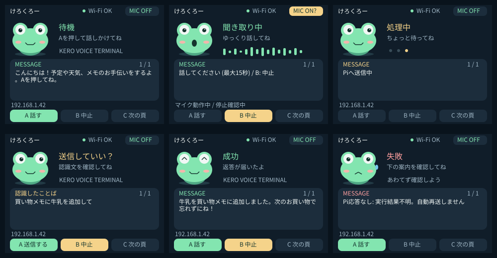

# Core2 Voice Terminal V1

M5Stack Core2 + Module LLM を、Pi 5 の **M5 Voice Bridge 専用の音声端末**にするファームウェアです。

```text
Core2 ─UART JSON─ Module LLM（マイク・日本語Whisper・MeloTTS・スピーカー）
  │
  └─Wi-Fi / HTTP / 端末トークン─ Pi: M5 Voice Bridge ─localhost─ OpenClaw Gateway
```

Wi-Fi/HTTPはCore2が担当し、Module LLMはUART経由で音声を処理します。Gatewayへの直接接続や、任意URL・シェルコマンドの実行機能はありません。Pi側の本番Bridgeは別途実装が必要です。本リポジトリの `tools/mock_bridge.py` はローカル契約テスト専用で、TODO・天気・ニュースの取得やメモ保存は実行しません。

## 操作

Core2の前面A/B/Cは**タッチボタン**です。側面の電源ボタンを会話用に転用しません。外付け物理スイッチは未実装です。

1. 起動時にModule LLMの既存タスクをリセットし、停止応答を確認。
2. **A**：Moduleを準備し、日本語Whisperを開始。「聞き取り中」の音が鳴ってから話す。
3. 発話終了をVADで検出。認識文を受け取ったらWhisperとVADを終了してマイク停止を確認。
4. 認識文を画面で確認。**A**でもう一度確認してPiへ送信。**B**で中止。
5. Bridgeの返答を画面に表示し、ModuleのMeloTTSへ再生を要求。
6. **C**で長い認識文・返答をページ送り。Aで次の会話、Bで再生停止。

状態は「待機 / 聞き取り中 / 処理中 / 成功 / 失敗」。成功は**Bridge処理成功とTTS要求送信**を意味し、実際の発声完了を保証しません。TTSのUART出力は音声データ転送を避けるため無効です。起動・各会話の `sys.reset` はModule上の他のStackFlowタスクも終了します。この端末専用Moduleで使用してください。モデルは会話ごとにロードするため、開始に数十秒かかることがあります。

聞き取り15秒、確認30秒、Module準備5〜30秒、Pi応答15秒の上限があります。再試行は自動では行いません。Piへ送信後の操作は取り消せないため、送信中のBは無効です。応答が失われた場合は「結果不明」とし、Pi側の履歴を確認してから次の操作を行います。

## カエルUI



カエル「けろくろー」がまばたきし、聞き取り・処理・成功・失敗に合わせて表情を変えます。上部にはWi-Fiとマイク状態、中央には認識文や返答、下部には操作できるボタンを表示します。長い文章はCでページ送りできます。聞き取り中のバーは状態を示す装飾で、実測音量ではありません。

`MIC ON?` はマイク動作中または停止未確認を示します。停止エラーは未設定時にも表示されます。描画バッファはPSRAMに置き、確保できない場合はアニメーションなしで直接描画します。アニメーションはキャラクター領域だけを毎秒8回更新します。

プレビューは実機と共通の描画コードから生成したものです。ホスト側フォントを使うため実機の文字の見え方とは多少異なります。再生成するには:

```bash
mkdir -p .build
c++ -std=c++17 -Wall -Wextra -Werror -Ilib/TerminalUi tools/ui_preview.cpp -o .build/ui_preview
.build/ui_preview > docs/ui-preview.svg
```

実機ではアニメーション中のボタン応答、文字表示、Wi-Fi通信との同時動作を確認してください。

## ビルド

Python 3.12、Git、C++コンパイラが必要です。PlatformIO 6.1.18、Espressif32 6.10.0 / Arduino ESP32 2.0.17、M5Unified 0.2.5、M5GFX 0.2.7、ArduinoJson 7.3.1を使用します。

```bash
bash tools/setup.sh
# 以後の増分ビルド
export PLATFORMIO_CORE_DIR="$PWD/.build/platformio"
.venv/bin/pio run -e core2 -j 4
bash tools/test.sh
```

認証情報なしでもビルドできます。そのバイナリは未設定画面を表示し、Wi-Fi送信・会話を開始しません。成果物は `.pio/build/core2/firmware.bin`、`.pio/build/core2/firmware.elf` です。

### このクラウド環境

PlatformIOレジストリのアクセスが許可されない環境向けに、GitHub上の公式ソースとPyPIを使う再現手順を用意しています。

```bash
export PLATFORMIO_CORE_DIR=/workspace/.platformio
export VOICE_VENV=/workspace/.venvs/core2
bash tools/setup.sh --upstream
# 以後
/workspace/.venvs/core2/bin/pio run -e core2 -j 4
```

`tools/bootstrap_cloud.py` はLinux x86_64用です。Espressifツールチェーンの公開SHA-256とソースのコミットを検証し、SCons/esptoolをPlatformIO用にローカル梱包します。依存物はcheckout外の `PLATFORMIO_CORE_DIR` に置きます。TLSやチェックサム検証は無効にしません。GitHubとPyPIが許可されていればビルドでき、PlatformIOレジストリの追加許可は通常の導入方式を使う場合に必要です。

## 実機設定・書き込み

1. [公式ピン切替手順](https://docs.m5stack.com/en/stackflow/module_llm/pins_change)に従って**電源を切った状態で**Module側をCore2用UARTへ変更。Core2 RX=GPIO13 / TX=GPIO14、115200 baud。Module TX→Core2 RX、Module RX←Core2 TX。Core2内蔵マイクはファームウェアで無効。音声入出力はModule側を使用。
2. ModuleのStackFlowサービスと `silero-vad`、日本語を含む `whisper-tiny`、`melotts-ja-jp` の導入・動作を確認。想定は1.6系以降のAPIですが、実機FWとの互換性は要確認。Core2画面にも `sys.version` 応答を表示します。モデル名は設定で変更できます。
3. `include/secrets.example.h` を `include/secrets.h` にコピーし、SSID・パスワード・Piの**プライベートIPv4**・24文字以上の端末専用トークンを設定。Piポートは8765。デバイスID、ピン、ポートは `include/config.h`。
4. [Bridge API仕様](docs/bridge-api.md)どおりのPi側サービスを準備。Gatewayはlocalhost限定のままにする。
5. USB接続できるPCでビルド・書き込み。

```bash
.venv/bin/pio run -e core2 -t upload --upload-port /dev/ttyUSB0
.venv/bin/pio device monitor --port /dev/ttyUSB0 --baud 115200
```

シリアルポート名はPCに合わせて変更してください。`secrets.h` はGit対象外です。設定済みバイナリには認証情報が含まれます。クラウド検証に実機のパスワード・トークンは不要です。

## 検証と実機で残る確認

`bash tools/test.sh` は本番と共通のC++状態機械・JSONフレーマをASan/UBSan付きで検証し、HTTP契約テストも実行します。CIではホストテストとESP32クロスビルドを実行します。

クラウドのビルド成功は実機の音声動作の確認とは別です。初回は次を実機で確認してください。

- ピン切替後の起動停止確認、FW表示、Wi-Fi IP表示。
- A→聞き取り→日本語認識→マイクOFF→確認→Bridge返答→日本語TTS。
- B中止、無音15秒、Module切断、Wi-Fi切断、Pi停止、401/403応答。
- 停止応答が来ないとき「停止未確認」と表示されること。その場合はModuleの電源を切る。
- 返答中は認識を再開しないこと。Aを押した場合はリセット後に次の会話を開始すること。
- 記録系の二重実行防止は**本番Bridge側の永続的な重複排除**で確認すること。

## プロトコルの参照元

- [M5Module-LLM公式サンプル](https://github.com/m5stack/M5Module-LLM/tree/161d9a7b69eaaa8e14579302c3f2c520e9920e5e/examples/KWS_VAD_Whisper)
- [StackFlow公式実装](https://github.com/m5stack/StackFlow/tree/0f0395377450e95364b90482e5f717f096413933/projects/llm_framework)

公式のaudio/VAD/Whisper/MeloTTS JSON構造を使用し、UIを止めない非同期UART状態機械を独自実装しています。起動語、常時待受、Tapo、外部送信、削除、購入はV1に含めません。
